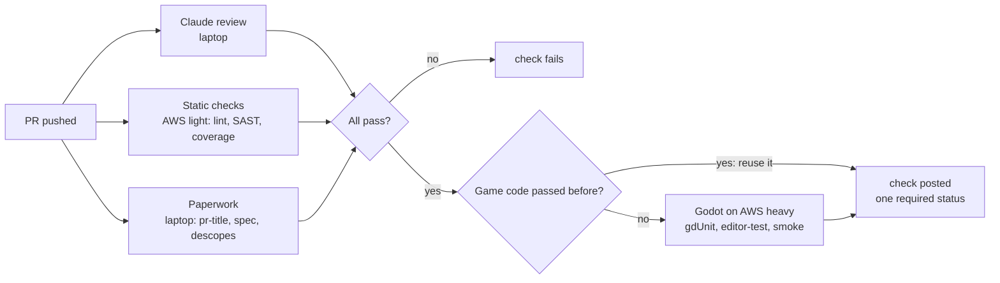

# Spellbound3d pipelines: laptop vs AWS plan

The tracked copy of the live plan doc, which is where Kieron edits and comments:
https://claude.ai/artifact/4Qz2sZifCSyJTwPvz8sV6L (private to Kieron). aws-build-machine's Claude updates both
together. If they differ, the doc is newer. Copy the change here in the same PR as anything that acts on it.

As of 21 Nov 2026.

## Status

All answers are in, and nothing is decided. The leading option: spellbound3d's change 0048 (check-pr on PRs, the full
check on main and every 3 hours), with the heavy pool on m7i.large. Add a Godot-free static job on light only if faster
failure is worth half a day.

| Item | Owner | Status | Notes |
| --- | --- | --- | --- |
| Draft the plan, price every option | aws-build-machine | In progress | All answers in; waiting on Kieron's decisions |
| Answers: per-target times, what needs Godot, gdUnit cores, effort | spellbound3d | Done | Received 21 Nov |
| Answers: staged checks, counter-proposal, constraints | claude-sdlc | Done | Received 21 Nov |
| Usage data: job counts, CPU and memory profile | aws-build-machine | Done | 19–20 Nov, and 55 heavy make checks |
| Decisions: the questions for Kieron below | Kieron | Not started | |
| Change 0048, check tiers (check-pr, FULL on main, 3-hourly full check, release gate) | spellbound3d | In progress | PR due 21 Nov; much of the counter-proposal comes with it |
| Measure one Godot process's peak memory on AWS | aws-build-machine | Not started | Decides parallel Godot on one machine |
| Trial m7i.large for the heavy pool | aws-build-machine | Not started | A pools.json change; spellbound3d owns its machine definitions |
| Staged check feature (with #190 and #225) | claude-sdlc | Not started | Only if Kieron picks stage B |
| SDLC_STACK_NEEDS, so light jobs skip Godot (PR #250) | claude-sdlc | In progress | In review |

## Today

Each pipeline runs one big `make check` on one c7i.xlarge. That machine uses about 1.1 of its 4 vCPUs on average, and
the check waits for a clean Claude review on the laptop.

- **Pipeline 1, a PR:** Claude review (laptop) → gate (laptop) → `make check` on AWS heavy (sdlc-check-after-review.yml).
- **Pipeline 2, a push to main:** `make check FULL=1` on AWS heavy (sdlc-ci.yml).
- **`make check`:** runner-smoke, lint, test (gdUnit) and editor-test in a row (skipped on docs-only changes). Then
  validate, standards, exec-bits, coverage and security in parallel.
- Both workflows are synced from claude-sdlc.

| Job | Runs on | Per day (19–20 Nov) | Typical length |
| --- | --- | --- | --- |
| Claude `review` | laptop | 25 | 2.6 min (max 6.5) |
| Check gate (after review) | laptop | 118 | 16 s |
| pr-title, descopes, spec | laptop | 52 | 15–30 s |
| `make check` | AWS heavy, c7i.xlarge spot | 61 | 478 s median machine time |

The heavy machine profile, from 55 make checks:

- **CPU:** 1.1 vCPU on average, p90 1.3 of 4.
- **Memory:** job peak 3.9 GB median and 4.4 GB max; machine peak up to 6.2 GB of 7.8 GB.
- **Setup:** 1–2 s since spellbound3d #220 and the prewarm image.

The heavy check is mostly single-threaded, so most of the machine sits idle.

## Proposed design

Split the check in two. Stage A runs the Claude review, the fast checks and the paperwork side by side. Stage B runs
Godot on AWS heavy only once all of A passes, and only for game code that hasn't already passed. GitHub still sees one
required `check`.

The review, the static checks and the paperwork run side by side. Godot waits for all three, and runs only for game code
that hasn't passed before; otherwise the earlier pass is reused.

| Stage | Job | Runs on | Software it needs | What it runs |
| --- | --- | --- | --- | --- |
| A | Claude review | laptop | node, Claude Code, gh | the review of intent and code |
| A | static | AWS light, c7i.large spot | uv and Python, gitleaks, the pinned linters; no Godot | validate, standards, coverage, security (gitleaks, ruff, shellcheck, zizmor, actionlint), gdlint, gdformat --check |
| A | paperwork | laptop (seconds of work) | gh, the sdlc scripts; no Godot | pr-title, spec, descopes |
| B | godot | AWS heavy (size: next section) | Godot 4.7.2 plus the stack | runner-smoke, project_check, test (gdUnit), editor-test |
| — | check (aggregator) | AWS light or laptop | none | passes when A passed, and B passed, was reused, or was skipped by design |
| — | gate | laptop | as today | unchanged: on AWS, about 80% of its cost would be boot time |

How it would be built (claude-sdlc's proposal, 21 Nov):

- **Shape:** fixed, not free-form. A `check: static` job runs `make $SDLC_PR_CHECK_TARGET` on a new `SDLC_RUNNER_CHECK`.
  A `check: heavy` job needs it, runs `SDLC_PR_HEAVY_TARGET` on `SDLC_RUNNER_HEAVY`, and runs only when the changed
  files match `SDLC_PR_HEAVY_PATHS`.
- **Before or after the review:** stage A can start before the review. claude-sdlc says #163's gate is mainly about cost,
  and fork PRs never reach these runners. Anything after the review keeps the after-review rules: no token in PR-code
  steps, and no action after PR code runs.
- **One required status:** `check` is posted after the last stage, with pending descriptions in between. The gate's
  queued and running descriptions must stay word for word (#237).
- **Main pushes:** the same split, or keep `make check FULL=1` as one heavy job, since main pushes are few.

## Keep Godot results through paperwork fixes (Kieron, 21 Nov)

A Godot pass should never be thrown away over paperwork. Paperwork runs first, so it fails in seconds, before any Godot
spend. A Godot pass then counts for that game code, whatever happens to the title, the docs or the PR around it.

**Do first, effort S (claude-sdlc):** spellbound3d already lets a build PR carry plan or spec changes if its body lists
them under `## Plan changes`. That fix is a body edit, which needs no new commit and no Godot run. But pr-title's error
ends "...or move them to a plan or spec PR", which reads as "split the docs out". Rewording it, so the body edit is the
first fix offered, removes most "3 docs into a new PR" cases on its own.

1. **Paperwork in stage A.** pr-title, spec and descopes run beside the review and the static checks. Godot never starts
   while any of them is failing. Today's after-review gate waits on claude-review only; it must also wait on pr-title
   and descopes.
2. **A title edit is not a commit.** pr-title re-runs on the PR's edited event alone. `check` belongs to the commit, so
   it stays green; nothing heavy re-runs.
3. **Reuse a pass for the same game code.** Stage B hashes the files Godot reads (the game tree, addons, project
   settings, version pins, the Godot tier's own scripts). If a same-repo run already passed for that hash, B posts
   "passed for this game code in run N" and skips. This covers a docs-only follow-up commit, a rebase that doesn't touch
   the game, and the case Kieron named: moving 3 docs out into a new PR.
4. **The release gate uses main's results.** It checks the commit being released, not a PR's paperwork, so a paperwork
   fix never costs a release its Godot run.

Open points for the build:

- **Trusted key, never PR code:** the hash and the pass/fail result must never come from anything the PR's code wrote.
  A same-repo PR (an agent steered into it, say) could forge a pass and poison other PRs. So a separate job that
  `needs:` the Godot job computes the key from git objects and records the pass from `needs.<job>.result`. Only that
  job holds the write credentials (the #163 care).
- **The hash's inputs:** two views to reconcile. spellbound3d prefers excluding a known list (the untested docs in
  check_scope.py's `godot` scope), so a missed file costs an extra run, not a hidden failure. claude-sdlc prefers
  listing the input paths. Both add the Godot version, the runner image (AMI) and the tier. The exclude list is safer.
  It can't be read by running the PR's check_scope.py, so the trusted job needs main's copy or a framework variable.
  If main moves or the image is rebuilt, Godot runs again.
- **Where passes are recorded:** the AWS artifacts bucket, keyed by hash. The Actions cache doesn't fit, because
  another PR can't see a PR's cache. The framework calls two consumer make targets, `heavy-pass-lookup` and
  `heavy-pass-record`, and only the AWS side knows about S3. Writing needs a new least-privilege OIDC role for that S3
  prefix: a policy change, so `approved: pending` until Kieron says yes. Under US$0.10 a month.
- **Effort:** claude-sdlc about a day (S–M) on top of the staged check, plus the S message fix. spellbound3d about half
  a day for the exclude list and hash. AWS about half a day for the role and the two targets' S3 side.
- **Under "light PR, heavy main"** this matters much less: no Godot editor stage runs on a PR, so a paperwork slip costs
  one check-pr re-run (about 2–3 minutes). Reuse is worth building only if Kieron keeps stage B on PRs.

## Machine sizes and parallelism on heavy

The Godot stage needs memory more than CPU. That points to m7i.large (2 vCPU, 8 GB) at about 40% less than today's
c7i.xlarge, unless gdUnit can be split to use more cores.

| Machine | vCPU | Memory | Spot price now, Sydney | Fit |
| --- | --- | --- | --- | --- |
| c7i.xlarge (today's heavy) | 4 | 8 GB | US$0.096–0.104/h | fits; about 3 vCPU idle |
| m7i.large | 2 | 8 GB | US$0.058–0.062/h | fits the 4.4 GB peak; the best value if the check stays single-threaded |
| m7i.xlarge | 4 | 16 GB | US$0.110–0.121/h | only if 3 or more Godot processes run at once |
| c7i.large (today's light) | 2 | 4 GB | US$0.045–0.055/h | too little memory for Godot; fine for stage A |
| t3a.large | 2 | 8 GB | US$0.038–0.040/h | no: 1.1 vCPU sustained is above its CPU allowance, so extra CPU would be billed |

Prices are from EC2 spot price history on 21 Nov 2026. Only approved types are listed.

There are two ways to run more in parallel (Kieron, 21 Nov):

1. **More at once on one machine.** Split gdUnit into 2–3 groups of suites, run as separate Godot processes, with
   editor-test and runner-smoke alongside. This uses c7i.xlarge's idle cores and cuts the wall time. Memory is the
   limit: it depends on each Godot process's peak.
2. **Shards across machines.** A matrix of 2–3 heavy jobs, each running a slice of the suites. It gives the fastest
   result, but each shard pays its own boot of about 40 s, uses more of the 8-runner limit, and the warnings summary,
   slow_suites and reports need merging.

Which wins depends on how long gdUnit itself takes (about 10 of 18 minutes in spellbound3d's laptop run) and on one
Godot process's peak memory.

## Options and monthly price

Every option stays well inside the US$29 stop. The split itself barely changes cost; the machine size does. Prices are
rough.

| Option | What changes | Runner cost per month (USD) | Result time | Notes |
| --- | --- | --- | --- | --- |
| 0. Today | nothing | about 10–15 | review, then about 8 min of check | |
| 1. Split, heavy stays c7i.xlarge | static on light beside the review; Godot after both | about 9–14 | static fails in about 1–2 min; Godot skipped on docs-only PRs | one extra light boot per push, about US$0.001 |
| 2. Split + m7i.large for Godot | as 1, the heavy machine 40% cheaper | about 7–11 | Godot about the same, if it stays single-threaded | the cheapest |
| 3. Split + parallel Godot on one c7i.xlarge | as 1, gdUnit in 2–3 processes | about 8–13 | Godot stage maybe 30–50% shorter | memory limits it; needs gdUnit split into groups |
| 4. Split + 2–3 shards on m7i.large | as 1, the suites across machines | about 9–14 | the fastest | uses more of the 8 runners; reports need merging |
| Add-on: Claude `review` on AWS | moves the review off the laptop (the subscription token costs the same anywhere; a reclaim only re-runs it) | +4–5 | | only if the laptop is the bottleneck |

Basis:

- **Volume:** 19–20 Nov, about 61 heavy and 196 laptop jobs a day, at 20–30 busy days a month.
- **Fixed costs:** about US$2.50 a month (snapshots, alarms, IPv4) are in every row.
- **Credits:** these currently cover all of it.

The Claude review's Anthropic tokens aren't included; they're the same in every option.

## Counter-proposal: light PR, heavy main (claude-sdlc, 21 Nov)

No Godot stage on PRs at all. Every PR push runs the review and `make check-pr` (already includes the headless core
gdUnit) side by side on AWS. The full Godot suite (editor-test, project_check) runs on main, every 3 hours in the AWS
window, and as the release gate. It needs no new framework feature, only variables.

- **Trade:** an editor-only Godot regression is found after merge, not before. Main red = fix first.
- **Machine:** `check-pr` runs gdUnit, so its machine needs about 8 GB: m7i.large, not today's 4 GB c7i.large light.
- **Rough price:** US$10–16 a month. The review moves to AWS (about 1.5 machine-hours a day). check-pr runs on every
  push, and heavy runs only for main and the schedule.
- **Model cost:** the review uses the subscription token, so it costs the same on any machine. A spot reclaim re-runs it
  and uses quota, not extra money.

Framework constraints it raised, which apply to every option:

1. **pr-title and claude-review are required checks**, on SDLC_RUNNER. If that's the laptop and it's asleep, or AWS
   outside 07:00–22:00, every PR blocks.
2. **Tiny jobs (5–10 s of work)** cost about 46 s of queue plus 34 s of setup on a fresh AWS machine. They're cheapest on
   GitHub-hosted runners or an always-on machine.
3. **Synced workflows aren't edited;** everything goes through variables (#190).
4. **The review runs PR code** (`make -n clauses`) wherever it runs, the laptop included. That's same-repo only.
5. **One required `check`;** check-gate.sh's status words must stay as they are (#237).
6. **One heavy runner variable:** SDLC_RUNNER_HEAVY covers a PR's check, main's `make check FULL=1`, after-review
   make-check and evals. Main can't get a bigger machine than PRs without per-job runner choice (#225). spellbound3d's
   own scheduled and release workflows can use any label already.

Answers from the AWS side:

- **(b) Can AWS share a label with the laptop?** Not as built. The launcher boots a machine for every queued job at once,
  so when the laptop takes the job, an AWS machine idles until the 20-minute reaper, at about US$0.017 each time. The fix
  is small (effort S): for a shared pool, launch only for jobs still queued after about 30 s, and reap idle machines
  after 2 minutes. Then the laptop takes what it can, and AWS takes the rest.
- **(c) GitHub-hosted minutes for the tiny jobs:** about 165 a day, each billed as a whole minute, so roughly
  3,300–5,000 minutes a month. That's above the Free plan's 2,000 private-repo minutes, and the overage would be billed
  by GitHub. It's outside the AWS cost boundary, and Kieron's call. His GitHub plan decides the price.

## What spellbound3d found (21 Nov)

gdUnit is the bulk of the check and is single-threaded, so it decides the machine. Stage A as drafted still needs Godot.

- **Where the time goes** (one full run on a loaded laptop, 17 m 45 s): gdUnit took 10 m 18 s (996 cases, 149 suites).
  Coverage leads the parallel group, because some Python test modules launch Godot (up to 297 s). Those run on a PR only
  when their files change, and always on FULL.
- **Needs Godot:** runner-smoke, lint's project_check step, test, editor-test, and coverage on FULL. **No Godot:**
  validate, standards, security, exec-bits, gdlint, gdformat.
- **Correction to stage A:** 0048's `check-pr` still runs Godot (runner-smoke, project_check, core gdUnit). A
  Godot-free static job needs its own tier and lint split in two. Effort: half a day.
- **Change 0048 lands today:** `check-pr` on PRs (core gdUnit only), FULL on main, a 3-hourly full check on AWS within
  07:00–22:00, a main-red issue and a release gate. Its steps are data (tools/ci/check_tiers.json), so regrouping is a
  config edit.
- **More cores:** gdUnit can be split by folder (`make test TESTS=res://tests/<folder>`). Parallel runs need their own
  report folders. Sharding is about a day: per-shard reports, a merged warnings summary, and slow_suites per shard.
  coverage_check isn't affected.
- **Still unknown:** one Godot process's peak memory. It decides whether 2–3 run at once on an 8 GB machine; AWS will
  measure it.

The 3-hourly full check adds about US$2–3 a month on heavy (5 runs a day of about 10 minutes).

## Open questions

For Kieron:

- [ ] Is faster feedback the goal, or lower cost, or keeping the laptop free? This decides between options 2, 3 and 4.
- [ ] Should the static stage start before the Claude review is clean? It runs same-repo PR code before review, and is
  cheap and fast. The alternative: everything waits for the review, as today.
- [ ] Stage B on PRs, or claude-sdlc's "light PR, heavy main"? It hinges on how often an editor-only Godot failure gets
  past check-pr.
- [ ] Reword pr-title's error so a `## Plan changes` body edit is the first fix (claude-sdlc, effort S)? It's
  independent of everything else and could go first.
- [ ] Should main pushes get the split too, or stay one `make check FULL=1` job?
- [ ] Should the laptop keep the Claude review, or move it to AWS (the add-on row)?
- [ ] Should claude-sdlc decide #225 (who picks runners) together with this? Are GitHub-hosted minutes acceptable for
  the tiny required jobs? And should the laptop share a label with AWS (a small launcher change)?

For spellbound3d: answered 21 Nov (see What spellbound3d found). Only one Godot process's peak memory is still open, to
be measured on AWS.

For claude-sdlc: answered on 21 Nov (see Proposed design and Feasibility and effort).

## Feasibility and effort

Feasible, at about 3–4 days in all, most of it in claude-sdlc. The pieces mostly exist already: SDLC_PR_CHECK_TARGET is
released, SDLC_STACK_NEEDS is in review, and the AWS light and heavy pools are both live.

| Repo | Work | Effort | Owner |
| --- | --- | --- | --- |
| claude-sdlc | staged check in both workflows (plain and after-review), 3–4 new variables, the path test, the `check` aggregator, the gate's status descriptions, sync settings, tests, a sandbox trial | M, about 1–2 days (claude-sdlc's estimate) | claude-sdlc |
| spellbound3d | `check-static` and `check-godot` make targets, heavy paths, repo variables; for options 3 and 4, splitting gdUnit into groups | 0048 lands 21 Nov; a Godot-free static tier and lint split, half a day; gdUnit sharding, about a day | spellbound3d |
| aws-build-runner | add m7i.large to the allowed sizes if needed, re-price, watch the first runs and report | S, about half a day | aws-build-machine |

Risks:

- **Synced workflows:** a local edit survives a sync but can conflict every time, so the split should be a claude-sdlc
  feature, not a local edit.
- **Paths filter:** a required check skipped by a `paths:` filter never reports, and the PR blocks. The heavy job must
  always run and exit early.
- **Runner limit:** shards and the extra light job use more of the 8-runner limit at busy times.

## Change log

| Date | Change |
| --- | --- |
| 21 Nov 2026 | claude-sdlc on reuse: the pr-title message fix first; the gate also waits on pr-title and descopes; a trusted job computes the key and records passes; S3 via two make targets and a new OIDC role (policy change) |
| 21 Nov 2026 | Reuse hash settled: the tested tree minus check_scope's untested docs, plus the AMI and tier (spellbound3d) |
| 21 Nov 2026 | Paperwork (pr-title, spec, descopes) joins stage A; Godot passes are reused for the same game code, so a paperwork fix never costs a Godot run (Kieron) |
| 21 Nov 2026 | Diagram: the "game files changed?" choice is its own decision; docs-only goes straight to the check |
| 21 Nov 2026 | Tracked copy added to the repo (part2-runner/PIPELINE-SPLIT.md) |
| 21 Nov 2026 | Added spellbound3d's answers (gdUnit 10 of 18 min, single-threaded; stage A needs its own Godot-free tier; 0048 lands today); leading option updated |
| 21 Nov 2026 | Added constraint 6: one SDLC_RUNNER_HEAVY for every heavy job (claude-sdlc) |
| 21 Nov 2026 | Added claude-sdlc's counter-proposal (light PR, heavy main), its framework constraints, and AWS answers on a shared laptop label and GitHub-hosted minutes |
| 21 Nov 2026 | Added claude-sdlc's answers on staged checks (effort M, 1–2 days; fold #225 in) |
| 21 Nov 2026 | Draft written: usage data, design, sizes, options; parallel Godot added at Kieron's request |
